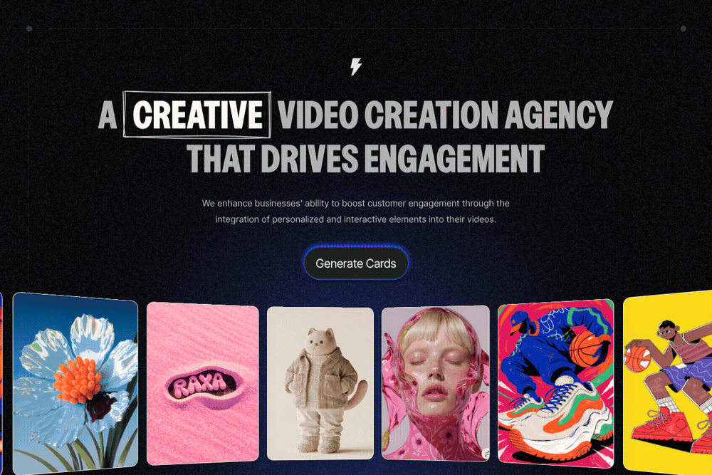
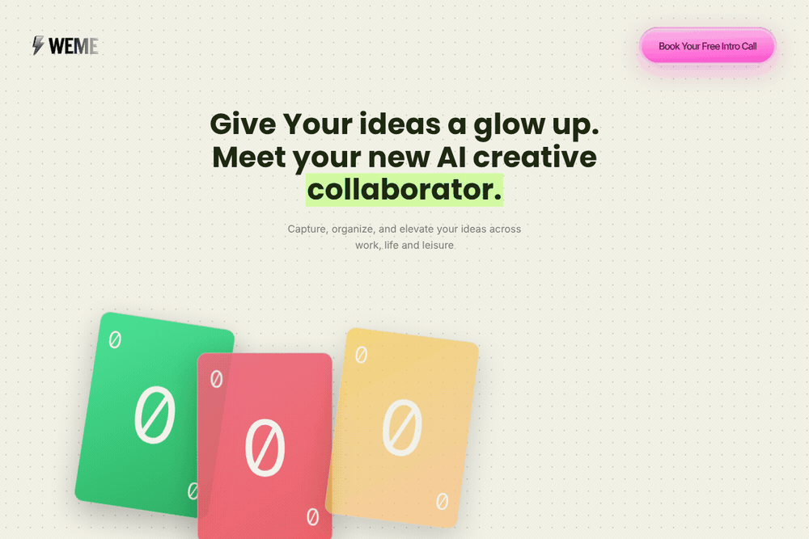
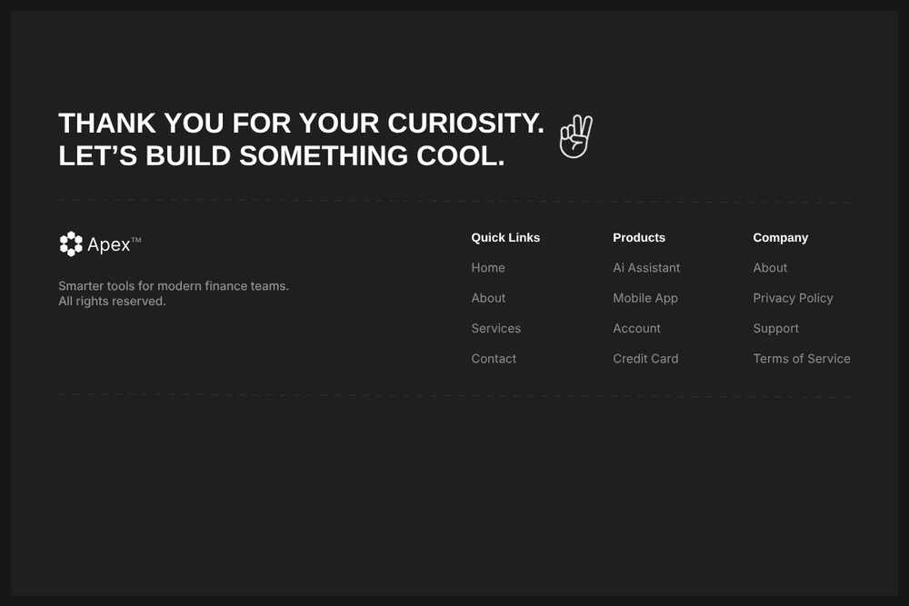
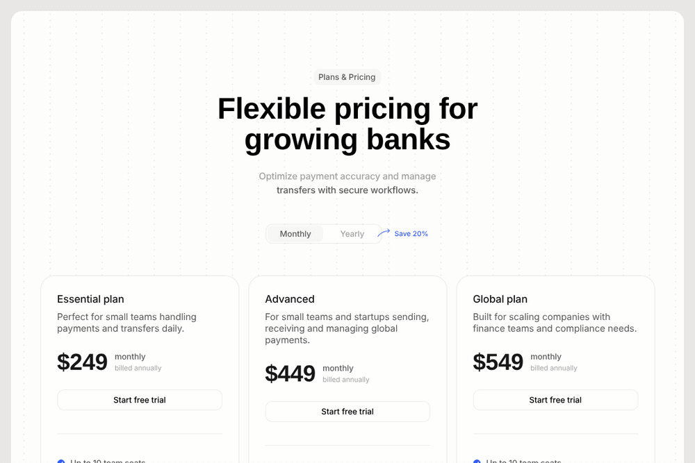

# Engineering Playground

Interaction and motion studies by **Hafsoh Bashar**, a product designer who designs in Figma and builds in code.

Each piece is plain HTML, CSS and JavaScript (no build step, no dependencies). Open it in a browser, or use the live links below. Most include a **Play demo** button that runs a scripted walkthrough, and **H** hides the controls for clean screen recording.

**Live gallery:** https://dhunidesigns.github.io/Engineering-Playground/

---


## 4AM: Subscription & Billing

The current plan card lifts and expands into a swipeable plans carousel. Pick a plan, subscribe, and the card lands back in the billing screen as your new plan, with a new transaction row and a toast. Adding a payment card shows a live card preview that fills in as you type.


Shared-element card expansion · spring-physics carousel with rubber-banding and flick velocity · blurred label crossfades · loading and success states · payment-methods sheet with an add-card form and live card preview

[Live demo](https://dhunidesigns.github.io/Engineering-Playground/4am-subscription/) · [Source](4am-subscription/index.html) · [Video](media/4am-subscription.mp4)

---

## LVL UP: Onboarding

Splash to three-page onboarding for a short-form learning app. Lesson cards shuffle, an AI tutor thinks and writes a summary word by word, and the community orbits around the app icon.


Animated splash and logo reveal · card shuffle · streaming text with skeleton loaders · orbiting avatars with pulse rings · swipeable pager with parallax

[Live demo](https://dhunidesigns.github.io/Engineering-Playground/lvlup-onboarding/) · [Source](lvlup-onboarding/index.html) · [Video](media/lvlup-onboarding.mp4)

---

## Ride Dispatch Dashboard

A tablet dashboard for booking rides, couriers and freight. The car drives the route on a vector map, ride progress fills as it moves, and booking a new driver updates the whole screen.


Animated route with a moving vehicle marker · live progress stepper and ETA · sliding tabs and mode switcher · skeleton loading · booking states and toasts

[Live demo](https://dhunidesigns.github.io/Engineering-Playground/ride-dashboard/) · [Source](ride-dashboard/index.html) · [Video](media/ride-dashboard.mp4)

---


## Travel Waitlist

A landing page for a travel launch, rebuilt from the Figma prototype. Hover a photo and it pops above the others. Hover the waitlist pill and it morphs straight into a frosted-glass form: the title slides up, Close drops in, and the description and fields rise one by one. Validation, a loading state and a personalised confirmation complete the flow.


Shared-element pill-to-card morph · backdrop blur and frosted glass · pointer-driven 3D tilt with glare · inline validation · success state that updates the page

[Live demo](https://dhunidesigns.github.io/Engineering-Playground/travel-waitlist/) · [Source](travel-waitlist/index.html) · [Video](media/travel-waitlist.mp4)

---

## Signature Pad

A signature modal for a referral partner agreement, shown on a tablet. Draw with smooth, pressure-like strokes, type it in a script typeface, or upload an image. Pick an ink colour, and Done flies the signature straight into the form.


Canvas drawing with velocity-based stroke width · sliding tabs · typeface dropdown with blurred swaps · drag-and-drop upload · shared-element transition into the form · bottom sheet on phones

**Upload flow:** choose or drop a JPG, PNG, PDF or SVG, watch it upload with live progress, remove or replace it, then drop it into the form.


[Live demo](https://dhunidesigns.github.io/Engineering-Playground/signature-pad/) · [Source](signature-pad/index.html) · [Draw & type video](media/signature-pad.mp4) · [Upload video](media/signature-upload.mp4)

---


## Video Creation Agency: Hero Section

A dark, high-contrast hero for a creative video agency, with a strip of stylised client thumbnails scrolling into view beneath the headline.



Bold grid-texture background · card strip reveal · generate-style CTA

[Live demo](https://dhunidesigns.github.io/Engineering-Playground/video-agency-hero/) · [Source](video-agency-hero/index.html)

---

## WEME: Give Your Ideas a Glow Up

A landing page for an AI creative collaborator. A fanned hand of fun, oversized cards sits in the hero — hover one and it lifts, tilts upright and nudges its neighbours apart.



Hover-responsive fanned card stack with neighbour displacement · glowing pill CTA

[Live demo](https://dhunidesigns.github.io/Engineering-Playground/weme/) · [Source](weme/index.html)

---

## Apex: Footer

A dark footer component for a fintech product, Apex. Colourful tag-shaped blobs fall into place on load, and the heading does a left-to-right character flip on hover.



Staggered blob fall-in entrance · per-character 3D flip-text heading on hover (ported from Vengeance UI's Flip Text)

[Live demo](https://dhunidesigns.github.io/Engineering-Playground/apex-footer/) · [Source](apex-footer/index.html)

---

## Apex: Pricing

A pricing section for Apex. Switching the Monthly/Yearly tab slides the toggle thumb and crossfades every plan's price to its annual rate, and starting a trial surfaces a confirmation toast instead of a dead link.



Keyboard-accessible ARIA tablist billing switch · animated price crossfade · toast confirmation on trial start

[Live demo](https://dhunidesigns.github.io/Engineering-Playground/apex-pricing/) · [Source](apex-pricing/index.html)

---

## Run locally

```bash
git clone https://github.com/DhuniDesigns/Engineering-Playground.git
cd Engineering-Playground
open index.html   # or double-click any index.html
```

Built with plain HTML, CSS and JavaScript (Web Animations API and spring physics, no frameworks).

---

Designed and built by **Hafsoh Bashar** ([@DhuniDesigns](https://github.com/DhuniDesigns)).
