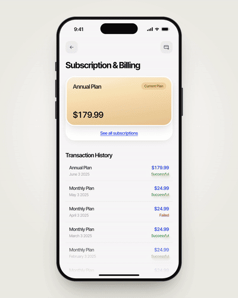
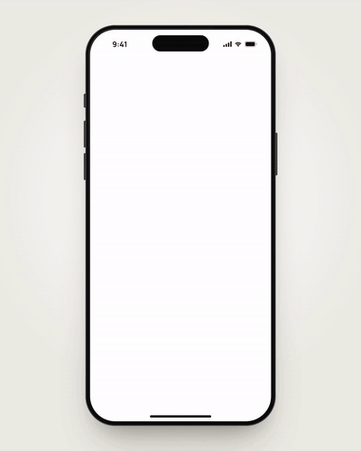
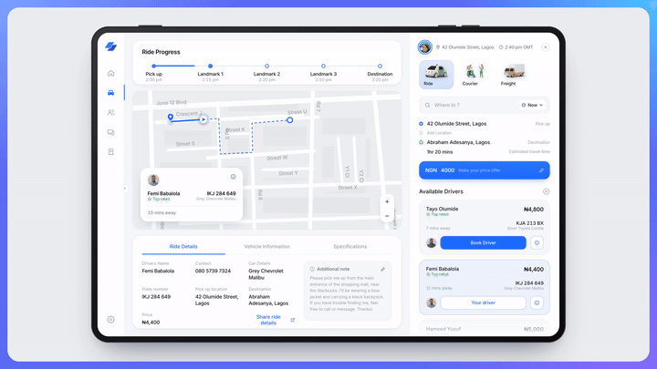
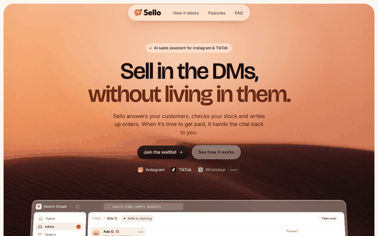
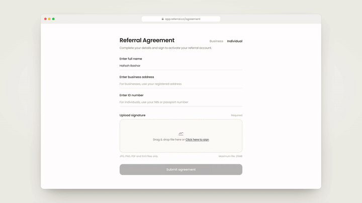

# Engineering Playground

Interaction and motion studies by **Muhammedfuad**, a product designer who designs in Figma and builds in code.

Each piece is plain HTML, CSS and JavaScript (no build step, no dependencies). Open it in a browser, or use the live links below. Most include a **Play demo** button that runs a scripted walkthrough, and **H** hides the controls for clean screen recording.

**Live gallery:** https://dhunidesigns.github.io/Engineering-Playground/

---

## 4AM: Subscription & Billing

The current plan card lifts and expands into a swipeable plans carousel. Pick a plan, subscribe, and the card lands back in the billing screen as your new plan, with a new transaction row and a toast. Adding a payment card shows a live card preview that fills in as you type.



Shared-element card expansion · spring-physics carousel with rubber-banding and flick velocity · blurred label crossfades · loading and success states · payment-methods sheet with an add-card form and live card preview

[Live demo](https://dhunidesigns.github.io/Engineering-Playground/4am-subscription/) · [Source](4am-subscription/index.html) · [Video](media/4am-subscription.mp4)

---

## LVL UP: Onboarding

Splash to three-page onboarding for a short-form learning app. Lesson cards shuffle, an AI tutor thinks and writes a summary word by word, and the community orbits around the app icon.



Animated splash and logo reveal · card shuffle · streaming text with skeleton loaders · orbiting avatars with pulse rings · swipeable pager with parallax

[Live demo](https://dhunidesigns.github.io/Engineering-Playground/lvlup-onboarding/) · [Source](lvlup-onboarding/index.html) · [Video](media/lvlup-onboarding.mp4)

---

## Ride Dispatch Dashboard

A tablet dashboard for booking rides, couriers and freight. The car drives the route on a vector map, ride progress fills as it moves, and booking a new driver updates the whole screen.



Animated route with a moving vehicle marker · live progress stepper and ETA · sliding tabs and mode switcher · skeleton loading · booking states and toasts

[Live demo](https://dhunidesigns.github.io/Engineering-Playground/ride-dashboard/) · [Source](ride-dashboard/index.html) · [Video](media/ride-dashboard.mp4)

---

## Sello: Marketing Site

The landing page for Sello, an AI sales assistant that answers Instagram and TikTok DMs, checks stock, writes up orders and hands the chat back to the seller to get paid. Fully responsive.



Product dashboard that zooms in on scroll · live AI inbox chat loop · a waitlist button that flies from the hero to the bottom of the screen and lands in the final CTA · auto-advancing steps with progress bars · scroll-driven feature rows · full-page footer with a rising wordmark

[Live site](https://sello-vert.vercel.app) · [Source](sello/)

---

## NYTA: Agency Site

A website for NYTA, a Dubai influencer agency that connects brands with local talent.


Editorial layout · auto-playing case-study slider · client testimonial carousel · responsive navigation

[Live site](https://nytaagency.vercel.app) · [Source](nyta-agency/)

---

## Signature Pad

A signature modal for a referral partner agreement, shown on a tablet. Draw with smooth, pressure-like strokes, type it in a script typeface, or upload an image. Pick an ink colour, and Done flies the signature straight into the form.



Canvas drawing with velocity-based stroke width · sliding tabs · typeface dropdown with blurred swaps · drag-and-drop upload · shared-element transition into the form · bottom sheet on phones

[Live demo](https://dhunidesigns.github.io/Engineering-Playground/signature-pad/) · [Source](signature-pad/index.html) · [Video](media/signature-pad.mp4)

---

## Run locally

```bash
git clone https://github.com/DhuniDesigns/Engineering-Playground.git
cd Engineering-Playground
open index.html   # or double-click any index.html
```

Built with plain HTML, CSS and JavaScript (Web Animations API and spring physics, no frameworks).
